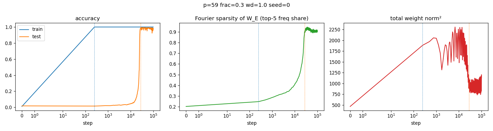
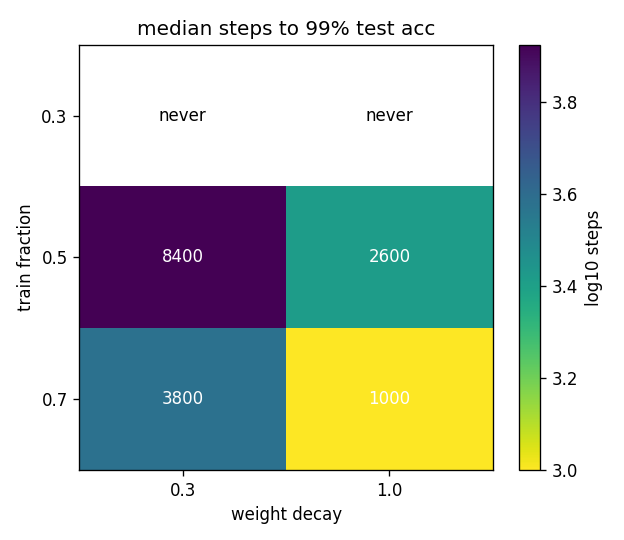

# grokking-progress-measures

Grokking on modular addition `(a + b) mod p` with a 1-layer transformer, following Nanda et al. 2023 (*Progress measures for grokking via mechanistic interpretability*). The repo covers:

- a reproduction;
- weight-decay × data-fraction sweeps;
- **progress measures** that move long before test accuracy does:
  - Fourier sparsity of the token embedding, i.e. the share of norm in the top-5 frequencies;
  - total weight norm.

[](https://colab.research.google.com/github/kishorhange111/grokking-progress-measures/blob/main/notebooks/colab_sweep.ipynb)

## Results (Tesla T4)

Same setup as the pilot below: p = 59, a 1-layer transformer with d = 128, AdamW at lr
1e-3, full-batch updates. "Memorise" and "generalise" are the first evaluation at which
train and test accuracy reach 99%. Files are in [`results/gpu/`](results/gpu).

### The 100k-step run (30% of pairs, weight decay 1.0, seed 0)



| step | test acc | test loss | top-5 Fourier share of W_E | weight norm² |
|---|---|---|---|---|
| 250 | 0.016 | 25.6 | 0.25 | 1,886 |
| 10,000 | 0.046 | 30.3 | 0.41 | 1,959 |
| 20,000 | 0.187 | 7.2 | 0.59 | 1,422 |
| 25,000 | 0.862 | 0.70 | 0.80 | 1,425 |
| 28,250 | **0.991** | 0.040 | 0.91 | 878 |
| 100,000 | 0.984 | 0.067 | 0.90 | 1,128 |

- **It groks.** It memorises at step 250 and generalises at step **28,250**, a delay of
  28,000 steps. The CPU pilot below was stopped at 25k steps, before it had generalised.
- **Hidden progress precedes the jump.** The Fourier share of the embedding climbs from
  0.25 to 0.59 by step 20k while test accuracy is still 19%. The weight norm peaks
  (2,309 at step 6,750) and then falls by more than half as the generalising circuit
  takes over. This is the clean-up phase Nanda et al. describe.
- **Generalisation holds.** After 30k steps test accuracy stays between 0.924 and 0.994
  and ends at 0.984. The final embedding is dominated by frequencies 12, 13, 20, 21 and 23.

### The sweep (3 data fractions × 2 weight decays × 3 seeds, 30k-step cap)



Delay is generalise − memorise, in steps (memorisation was at step 200 in every run).

| train fraction | weight decay 0.3 | weight decay 1.0 |
|---|---|---|
| 0.3 | never, 3 of 3 seeds | 28,200 and 29,000; one seed never |
| 0.5 | 8,200 / 13,400 / 7,200 | 2,400 / 3,600 / 1,000 |
| 0.7 | 3,600 / 4,400 / 1,800 | 800 / 1,000 / 800 |

- **More data shortens the delay**, and **more weight decay shortens it too**. Each seed
  is faster at weight decay 1.0 than at 0.3 for both fractions where both generalise,
  by 2.3–7.2×.
- **At 30% of pairs the delay is near the 30k cap.** With weight decay 0.3, none of the
  three seeds generalised within 30k steps, and their test accuracy ended at 3–6%. With
  1.0, two of three did, at 28.2k and 29.0k, matching the long run. Seed 2 had not
  generalised by the cap, so its outcome at longer horizons is unknown.
- **The Fourier measure separates the outcomes.** Runs that generalised end with a top-5
  Fourier share of 0.77–0.93. The four that never did end at 0.32–0.44.

The full table is [results/gpu/sweep/sweep.md](results/gpu/sweep/sweep.md).

## Pilot (CPU, 25k steps, single seed)

The pilot used p = 59, 30% of pairs for training, weight decay 1.0, AdamW lr 1e-3 and full-batch updates (`results/single_p59_frac0.3_wd1.0_seed0.*`).

| step | train acc | test acc | top-5 Fourier share of W_E | weight norm² |
|---|---|---|---|---|
| 0 | 0.011 | 0.018 | 0.20 | 468 |
| 2,500 | **1.000** | 0.025 | 0.32 | 1,855 |
| 10,000 | 1.000 | 0.041 | 0.40 | 2,206 |
| 17,500 | 1.000 | 0.096 | 0.49 | 1,976 |
| 25,000 | 1.000 | **0.243** | **0.61** | 1,848 |

- **Memorisation is immediate.** Training accuracy reaches 99% at step 200.
- **The Fourier progress measure leads test accuracy.** Between steps 2.5k and 25k, Fourier sparsity rises almost monotonically (0.32 → 0.61) while test accuracy is still near chance (2.5% → 24%). The embedding is reorganising around a few frequencies (7, 12, 20, 21, 23) well before the generalising circuit shows up in accuracy. This is the "hidden progress" Nanda et al. describe.
- **The run had not generalised by 25k steps**, and the weight norm is still near its peak rather than in the clean-up phase. The long run and the multi-seed sweep in the Colab notebook test whether this run eventually groks and how the delay depends on weight decay and data fraction.

This is a single seed on CPU, so treat it as a pilot, not a result.

## Run

All experiments run on **Google Colab** (badge above). The notebook runs:

- the sweep: 3 train fractions × 2 weight decays × 3 seeds, four processes sharing one GPU, resumable via `runs.jsonl` on Drive;
- a 100k-step single run.

Locally (CPU), for development:

```
pip install -e ".[dev]"
pytest -q
python -m grok.cli single --p 59 --frac 0.3 --wd 1.0 --steps 2000 --device cpu
python -m grok.cli sweep --fracs 0.3 0.5 --wds 0.3 1.0 --seeds 0 --device auto --workers 2
```
